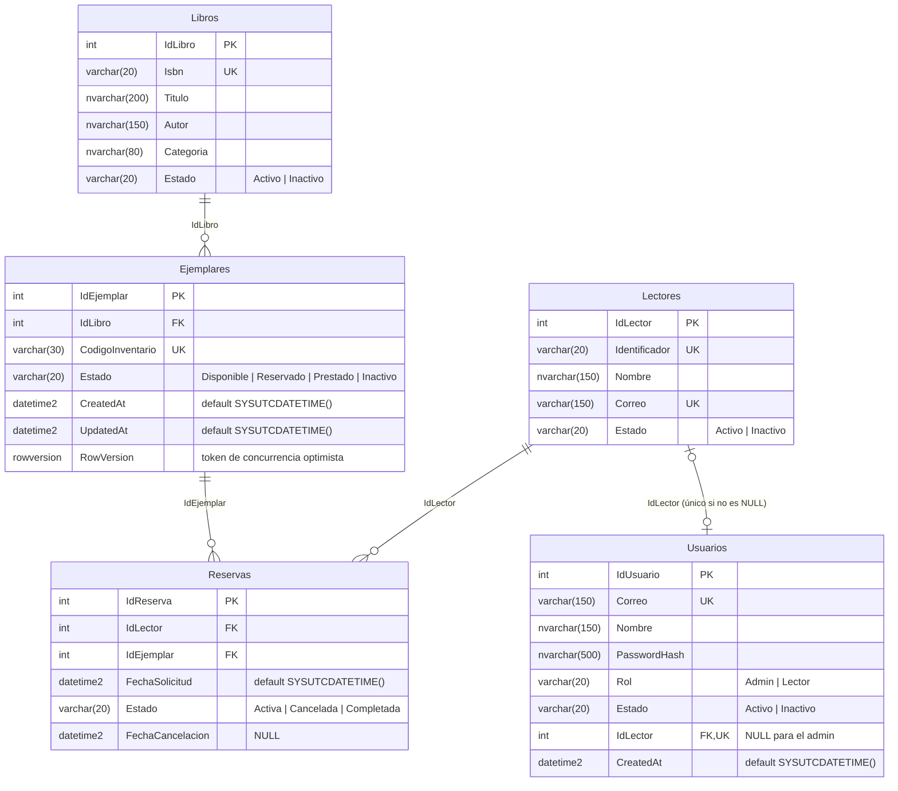

# backend-asa

API REST de una biblioteca: catálogo de libros, ejemplares físicos, lectores y reservas. La regla central es que dos personas nunca se queden con la misma copia, aunque reserven en el mismo instante.

El frontend vive en otro repo: [frontend-asa](https://github.com/CristanPalma2203/frontend-asa).

## Stack

- .NET 10 con minimal APIs.
- EF Core 10 sobre SQL Server 2022.
- FluentValidation para las entradas.
- JWT Bearer para autenticación, con roles `Admin` y `Lector`.
- OpenAPI más Scalar en Development.
- xUnit, FluentAssertions, Testcontainers (SQL Server) y Respawn para los tests.
- Docker con build multi-stage y Docker Compose (API + SQL Server).

## Arquitectura

Uso **Vertical Slice**. Cada caso de uso es una carpeta `Features/<Área>/<Operación>/` con un archivo por pieza: `Endpoint.cs` (`IEndpoint`), `Handler.cs`, `Request.cs`, `Response.cs` y `Validator.cs`; solo están los que la operación necesita. Lo que comparten varias operaciones de un área queda en la raíz del área (`LibroIsbn`, `CodigoInventario`, `RowVersionToken`, `ReservaDetalle`, `Acceso`). Los endpoints se registran solos por reflexión (`AddEndpoints` / `MapEndpoints`).

```
Common/          Endpoints, Result/Error, ProblemDetails, validación, paginación, OpenAPI
Domain/          Entidades y enums (Libro, Ejemplar, Lector, Reserva, Usuario)
Features/        Casos de uso: una carpeta por área y una subcarpeta por operación (detalle abajo)
Infrastructure/  DbContext, configuraciones EF, converters, migraciones y seed
scripts/         migrations.sql idempotente
tests/           Tests de integración contra SQL Server real
```

```
Features/
├── Auth/
│   ├── Login/            Endpoint.cs, Handler.cs, Request.cs, Response.cs, Validator.cs
│   ├── Me/               Endpoint.cs
│   ├── Acceso.cs
│   ├── AuthOptions.cs
│   └── BearerSecuritySchemeTransformer.cs
├── Ejemplar/
│   ├── CambiarEstado/    Endpoint.cs, Handler.cs, Request.cs, Validator.cs
│   ├── Crear/            Endpoint.cs, Handler.cs, Request.cs, Response.cs, Validator.cs
│   ├── Desactivar/       Endpoint.cs, Handler.cs, Request.cs, Validator.cs
│   ├── Editar/           Endpoint.cs, Handler.cs, Request.cs, Validator.cs
│   ├── Listar/           Endpoint.cs, Handler.cs, Request.cs, Response.cs, Validator.cs
│   ├── CodigoInventario.cs
│   └── RowVersionToken.cs
├── Lector/
│   ├── Crear/            Endpoint.cs, Handler.cs, Request.cs, Response.cs, Validator.cs
│   ├── Desactivar/       Endpoint.cs, Handler.cs, Request.cs, Validator.cs
│   ├── Editar/           Endpoint.cs, Handler.cs, Request.cs, Validator.cs
│   ├── Listar/           Endpoint.cs, Handler.cs, Request.cs, Response.cs, Validator.cs
│   └── Obtener/          Endpoint.cs, Handler.cs, Request.cs, Response.cs, Validator.cs
├── Libro/
│   ├── Crear/            Endpoint.cs, Handler.cs, Request.cs, Response.cs, Validator.cs
│   ├── Desactivar/       Endpoint.cs, Handler.cs, Request.cs, Validator.cs
│   ├── Editar/           Endpoint.cs, Handler.cs, Request.cs, Validator.cs
│   ├── Listar/           Endpoint.cs, Handler.cs, Request.cs, Response.cs, Validator.cs
│   ├── Obtener/          Endpoint.cs, Handler.cs, Request.cs, Response.cs, Validator.cs
│   └── LibroIsbn.cs
└── Reserva/
    ├── Cancelar/         Endpoint.cs, Handler.cs, Request.cs, Validator.cs
    ├── Crear/            Endpoint.cs, Handler.cs, Request.cs, Response.cs, Validator.cs
    ├── ListarPorLector/  Endpoint.cs, Handler.cs, Request.cs, Validator.cs
    ├── Obtener/          Endpoint.cs, Handler.cs, Request.cs, Validator.cs
    └── ReservaDetalle.cs
```

Los handlers devuelven `Result` / `Result<T>` y no lanzan excepciones para los errores de negocio. `ResultExtensions.ToHttpResult()` traduce cada `ErrorType` a su status HTTP.

### Decisiones

**Concurrencia de reservas.** `POST /api/reservas` abre una transacción `ReadCommitted`, valida lector, libro y reserva duplicada, y toma una copia así:

```sql
SELECT TOP (1) e.*
FROM Ejemplares AS e WITH (UPDLOCK, READPAST, ROWLOCK)
WHERE e.IdLibro = {libroId} AND e.Estado = 'Disponible'
ORDER BY e.CodigoInventario
```

`UPDLOCK` + `ROWLOCK` bloquean solo esa fila hasta el commit. `READPAST` hace que una transacción concurrente salte la fila bloqueada y tome la siguiente copia libre en vez de esperar. Si no queda ninguna, respondo `409 sin-stock`.

Antes de verificar la reserva duplicada, la misma transacción bloquea la fila del lector:

```sql
SELECT * FROM Lectores WITH (UPDLOCK, ROWLOCK) WHERE IdLector = {lectorId}
```

Sin este bloqueo había una carrera: si el mismo lector enviaba varias reservas del mismo libro a la vez, todas veían "no hay reserva activa" y, como `READPAST` les da copias distintas, el índice único no las frenaba y se creaban varias. Con `UPDLOCK` la segunda petición del mismo lector espera a que la primera haga commit y entonces ve su reserva, así que responde `422 reserva-duplicada`. Solo se serializan las reservas del mismo lector; las de lectores distintos no se esperan entre sí. Un test lanza cuatro reservas simultáneas de Ana sobre un libro con tres copias y comprueba un 201, tres `reserva-duplicada` y una sola reserva activa.

Como segunda barrera, `IX_Reservas_IdEjemplar_Activa` es un índice **único filtrado** (`[Estado] = 'Activa'`). Si por cualquier camino se intentara una segunda reserva activa del mismo ejemplar, SQL Server lo rechaza (2601/2627) y respondo `409 ejemplar-ya-reservado`. Un test dispara dos reservas simultáneas de la única copia y comprueba un 201, un 409 y una sola reserva activa.

**Stock calculado.** No guardo un contador. "Disponibles" es el conteo de ejemplares en estado `Disponible`, así nunca se desfasa del estado real de cada copia.

**Concurrencia optimista con `rowversion`.** `Ejemplar.RowVersion` es `rowversion`. Lo envío en base64 y el cliente lo devuelve al cambiar el estado de un ejemplar o al editarlo. Si otro usuario lo modificó antes, EF lanza `DbUpdateConcurrencyException` y respondo `409 conflicto-concurrencia`.

**Errores como ProblemDetails con `code`.** Todas las respuestas de error son `application/problem+json` con una extensión `code` en kebab-case (`sin-stock`, `lector-inactivo`…). El frontend decide qué mostrar por `code`, no por el texto. Las validaciones devuelven `400 validacion-fallida` con `errors` por campo. `GlobalExceptionHandler` cubre concurrencia, duplicados e internos.

**Contrato JSON.**

- Los enums viajan como texto (`"estado": "Activa"`). Uso `JsonStringEnumConverter` y el OpenAPI los declara `type: string`.
- Las fechas salen en UTC con `Z`. Un `ValueConverter` global marca como `Utc` todo `DateTime` leído de SQL Server, y los handlers guardan con `TimeProvider.GetUtcNow()`.
- Las reservas exponen `fechaSolicitud` y `fechaCancelacion`, y los ejemplares `idEjemplar`.

**Checks en la base.** `CK_Libro_Estado`, `CK_Ejemplar_Estado`, `CK_Lector_Estado`, `CK_Reserva_Estado`, `CK_Usuario_Rol`, `CK_Usuario_Estado` y `CK_Reserva_FechaCancelacion` (si el estado es `Cancelada`, la fecha es obligatoria).

## Base de datos

Sacado de `Infrastructure/Persistence/Configurations/*.cs`; los tipos son los que genera la migración. `PK` clave primaria (`int IDENTITY`), `FK` clave foránea, `UK` único.



Todas las FK son `ON DELETE RESTRICT`: no hay borrado físico en cascada, las bajas son lógicas por `Estado`. Un lector tiene a lo sumo un usuario (`IX_Usuarios_IdLector`), y un usuario puede no tener lector (el admin).

**Índices**

| Índice | Tabla | Columnas | Tipo |
| --- | --- | --- | --- |
| `IX_Libros_Isbn` | Libros | `Isbn` | Único |
| `IX_Libros_Estado` | Libros | `Estado` | |
| `IX_Ejemplares_CodigoInventario` | Ejemplares | `CodigoInventario` | Único |
| `IX_Ejemplares_IdLibro` | Ejemplares | `IdLibro` | |
| `IX_Ejemplares_Estado` | Ejemplares | `Estado` | |
| `IX_Ejemplares_IdLibro_Estado` | Ejemplares | `IdLibro`, `Estado` | Compuesto (conteo de disponibles) |
| `IX_Lectores_Identificador` | Lectores | `Identificador` | Único |
| `IX_Lectores_Correo` | Lectores | `Correo` | Único |
| `IX_Reservas_IdLector` | Reservas | `IdLector` | |
| `IX_Reservas_IdEjemplar` | Reservas | `IdEjemplar` | |
| `IX_Reservas_IdEjemplar_Activa` | Reservas | `IdEjemplar` | **Único filtrado** `WHERE [Estado] = 'Activa'`: una sola reserva activa por ejemplar |
| `IX_Reservas_Estado` | Reservas | `Estado` | |
| `IX_Usuarios_Correo` | Usuarios | `Correo` | Único |
| `IX_Usuarios_IdLector` | Usuarios | `IdLector` | Único filtrado `WHERE [IdLector] IS NOT NULL` |

**CHECK**

| Restricción | Tabla | Condición |
| --- | --- | --- |
| `CK_Libro_Estado` | Libros | `[Estado] IN ('Activo', 'Inactivo')` |
| `CK_Ejemplar_Estado` | Ejemplares | `[Estado] IN ('Disponible', 'Reservado', 'Prestado', 'Inactivo')` |
| `CK_Lector_Estado` | Lectores | `[Estado] IN ('Activo', 'Inactivo')` |
| `CK_Reserva_Estado` | Reservas | `[Estado] IN ('Activa', 'Cancelada', 'Completada')` |
| `CK_Reserva_FechaCancelacion` | Reservas | `([Estado] <> 'Cancelada') OR ([FechaCancelacion] IS NOT NULL)` |
| `CK_Usuario_Rol` | Usuarios | `[Rol] IN ('Admin', 'Lector')` |
| `CK_Usuario_Estado` | Usuarios | `[Estado] IN ('Activo', 'Inactivo')` |

**Stock disponible.** No existe una columna de stock: `disponibles` es `COUNT(*)` de los `Ejemplares` del libro con `Estado = 'Disponible'`, calculado en cada consulta y apoyado en `IX_Ejemplares_IdLibro_Estado`.
Reservar, cancelar o desactivar solo cambian el `Estado` de un ejemplar, así que el número no puede desfasarse de las copias reales.

## Cómo correrlo

### Visual Studio / IIS Express (Development)

1. SQL Server local. La cadena por defecto (`appsettings.Development.json`) es `Server=localhost;Database=database-asa;Integrated Security=True;TrustServerCertificate=True`. Si la tuya es otra, cámbiala ahí o en la variable `ConnectionStrings__database-asa`.
2. Abro `backend-asa.slnx` y arranco el perfil **IIS Express** (`https://localhost:44358`) o **https** (`https://localhost:7212`). Con la CLI: `dotnet run --launch-profile https`.
3. En Development, `Program.cs` corre `MigrateAsync`, que aplica las migraciones y el seed. Scalar queda en `/scalar` (y `/` redirige ahí).

### Docker Compose

```bash
cp .env.example .env     # y cambio todos los valores marcados CAMBIAR
docker compose up --build
```

- `db`: SQL Server 2022 con volumen `mssql-data` y healthcheck con `sqlcmd`. No publico el 1433 al host.
- `api`: imagen local multi-stage (`sdk:10.0` → `aspnet:10.0`), corre como usuario no root `app` en el puerto 8080, con `HEALTHCHECK` a `/health`. Arranca cuando `db` está healthy.
- La API queda en `http://localhost:8080` y el health check en `http://localhost:8080/health`.

Todos los secretos (contraseña de `sa`, `JWT_KEY`, contraseñas del seed) salen de `.env`, que no se versiona.

Por defecto el contenedor corre en `Production`: sin Scalar ni OpenAPI. Con `ASPNETCORE_ENVIRONMENT=Development` en `.env` se publican.

**Migraciones al arrancar.** Fuera de Development no migro ni siembro, salvo que `Database:MigrateOnStartup=true` (variable `Database__MigrateOnStartup`). Compose la pone en `true` para que la base quede lista sola. En un despliegue real la dejaría apagada y aplicaría `scripts/migrations.sql`.

Para empezar de cero: `docker compose down -v` (borra el volumen de la base).

## Usuarios demo

El seed crea dos usuarios en la tabla `Usuarios`. En la base guardo solo el hash.

| Correo | Rol | Contraseña |
| --- | --- | --- |
| admin@demo.local | Admin | `Seed:AdminPassword` |
| ana.lopez@demo.local | Lector (ligada al lector Ana López) | `Seed:LectorPassword` |

Las contraseñas no están en este README. Salen de:

- En Visual Studio / Development: `appsettings.Development.json` → sección `Seed`.
- En Docker: `.env` → `SEED_ADMIN_PASSWORD` y `SEED_LECTOR_PASSWORD`.

Si faltan, el seed no crea usuarios.

El token lleva `sub`, `email`, `role` y, si el usuario tiene lector, `lector_id`. En Scalar elijo el esquema Bearer y pego el `accessToken` de `POST /api/auth/login`, sin la palabra `Bearer`.

## Endpoints principales

| Método | Ruta | Quién | Qué hace |
| --- | --- | --- | --- |
| POST | /api/auth/login | Público | Entrega el JWT |
| GET | /api/auth/me | Autenticado | Rol, nombre y lector del token |
| GET | /api/libros | Público | Libros activos paginados. `buscar` (o su alias `search`): contiene, en título, autor o ISBN. `autor`: contiene, sin distinguir mayúsculas. `categoria`: exacta. `page`, `pageSize` |
| GET | /api/libros/{id} | Público | Detalle, disponibles y ejemplares |
| POST | /api/libros | Admin | Crea un libro |
| PUT | /api/libros/{id} | Admin | Edita ISBN, título, autor y categoría |
| DELETE | /api/libros/{id} | Admin | Baja lógica. 422 si hay reservas activas |
| GET | /api/libros/{idLibro}/ejemplares | Admin | Copias con `rowVersion` en base64 |
| POST | /api/libros/{idLibro}/ejemplares | Admin | Alta de copia en `Disponible` |
| PUT | /api/libros/{idLibro}/ejemplares/{idEjemplar}/estado | Admin | Solo `Disponible` ↔ `Inactivo`, con `rowVersion` |
| PUT | /api/ejemplares/{id} | Admin | Edita el `codigoInventario`, con `rowVersion`. 409 por código duplicado o por concurrencia |
| DELETE | /api/ejemplares/{id} | Admin | Baja lógica (pasa a `Inactivo`). 422 `ejemplar-reservado` si está reservado |
| POST | /api/reservas | Autenticado | Reserva una copia. El lector usa su `lector_id`; Admin puede indicar otro |
| GET | /api/reservas/{id} | Dueño o Admin | Detalle de una reserva |
| POST | /api/reservas/{id}/cancelar | Dueño o Admin | Cancela y libera la copia |
| GET | /api/lectores/{lectorId}/reservas | Ese lector o Admin | Paginado, la más reciente primero (`estado` opcional) |
| GET | /api/lectores | Admin | Lectores paginados e indica si tienen usuario |
| GET | /api/lectores/{id} | Admin | Detalle y reservas activas |
| POST | /api/lectores | Admin | Crea el lector; con `password` (8+) crea también su usuario |
| PUT | /api/lectores/{id} | Admin | Edita datos y el correo del usuario ligado |
| DELETE | /api/lectores/{id} | Admin | Baja lógica del lector y de su usuario |
| GET | /health | Público | Comprueba la conexión a la base |

## Códigos de error

| Código | Status |
| --- | --- |
| validacion-fallida | 400 |
| no-autenticado | 401 |
| credenciales-invalidas | 401 |
| acceso-denegado | 403 |
| libro-no-encontrado | 404 |
| ejemplar-no-encontrado | 404 |
| lector-no-encontrado | 404 |
| reserva-no-encontrada | 404 |
| isbn-duplicado | 409 |
| codigo-inventario-duplicado | 409 |
| correo-duplicado | 409 |
| identificador-duplicado | 409 |
| sin-stock | 409 |
| ejemplar-ya-reservado | 409 |
| conflicto-concurrencia | 409 |
| registro-duplicado | 409 |
| libro-inactivo | 422 |
| lector-inactivo | 422 |
| reserva-duplicada | 422 |
| reserva-no-activa | 422 |
| libro-con-reservas-activas | 422 |
| lector-con-reservas-activas | 422 |
| estado-no-permitido | 422 |
| ejemplar-reservado | 422 |
| error-interno | 500 |

## Tests

Necesitan **Docker encendido**: Testcontainers levanta un SQL Server 2022 desechable.

```bash
dotnet test tests/backend-asa.Tests/backend-asa.Tests.csproj
```

Son tests de integración de punta a punta (HTTP → API → SQL Server real). La fixture migra y siembra una vez, y Respawn limpia la base entre tests. Son 32 y cubren:

- **Libros:** listado con datos iniciales, `search` como alias de `buscar`, filtro `autor` sin distinguir mayúsculas, alta como admin, ISBN duplicado e ISBN inválido.
- **Ejemplares:** código duplicado, que no se pueda inactivar una copia reservada, editar con `rowVersion` vieja (`409 conflicto-concurrencia`) y desactivar una copia sin borrarla.
- **Reservas:**
  - stock al reservar y al cancelar;
  - cancelar dos veces: la segunda da `422 reserva-no-activa` y no cambia nada;
  - lector inactivo, sin stock y reserva duplicada;
  - 401 sin token y 403 si un lector reserva por otro;
  - **dos reservas simultáneas de la única copia**;
  - **cuatro reservas simultáneas del mismo lector y libro**: un 201 y tres `reserva-duplicada`.
- **Lectores:** correo duplicado, baja con reservas activas, 403 para un lector, alta con y sin contraseña, y contraseña corta.
- **Usuarios:** un usuario inactivo no entra.
- **Contrato:**
  - enums como texto en JSON y en OpenAPI;
  - `fechaSolicitud` y `fechaCancelacion` en UTC con `Z`;
  - `idEjemplar` en el detalle y en el listado.
- **Migraciones:** que el modelo no tenga cambios pendientes (`HasPendingModelChanges`).

## Migraciones y `scripts/migrations.sql`

Las migraciones están en `Infrastructure/Persistence/Migrations`. Las aplico de cuatro maneras:

1. Automática en Development, con `MigrateAsync` al arrancar.
2. Automática en Docker, con `Database__MigrateOnStartup=true`.
3. A mano: `dotnet ef database update --project backend-asa.csproj`.
4. Con el script idempotente `scripts/migrations.sql`, que puede correrse varias veces sin romper nada:

   ```bash
   sqlcmd -S localhost -d database-asa -E -i scripts/migrations.sql
   ```

   Se regenera con `dotnet ef migrations script --idempotent -o scripts/migrations.sql`.

## Supuestos

- Una reserva asigna una copia concreta al momento. No hay cola de espera: sin copias libres, la respuesta es `sin-stock`.
- Un lector no puede tener dos reservas activas del mismo libro.
- Las bajas son lógicas (estado `Inactivo`). No borro filas con historial.
- Desde la API, un ejemplar solo pasa entre `Disponible` e `Inactivo`. `Reservado` lo gestionan las reservas y `Prestado` existe en el enum, pero aún no hay flujo de préstamo.
- Todas las fechas se guardan y se devuelven en UTC. Convertir a la zona del usuario es tarea del cliente.
- El contenedor solo sirve HTTP en 8080. TLS lo pondría un proxy o ingress delante. Por eso el log avisa que no encuentra puerto HTTPS para redirigir.
- Las claves de Data Protection viven dentro del contenedor. La API no las usa para datos persistentes (el JWT se firma con `Jwt:Key`), así que se pueden perder sin efecto.

Con más tiempo haría esto:

- Préstamo y devolución.
- Refresh token con caducidad más corta.
- `UserSecretsId` para sacar la cadena de `appsettings.Development.json`.
- Seguridad OpenAPI por operación en vez de un Bearer global.

## Autor

Alex Palma. [LinkedIn](https://www.linkedin.com/in/cristian-palma-07a407259) y [GitHub](https://github.com/CristanPalma2203).
