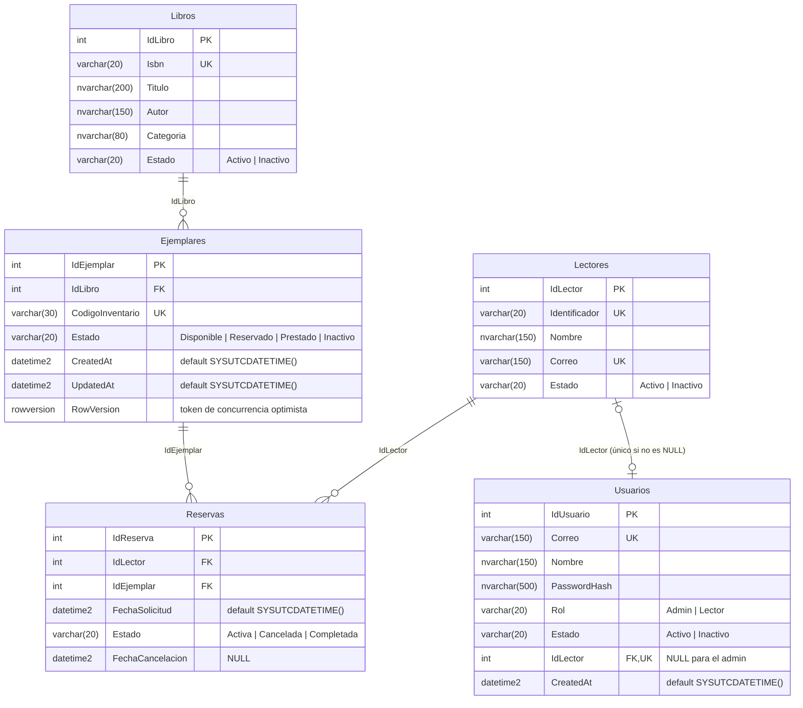

# backend-asa

[](https://github.com/CristanPalma2203/backend-asa/actions/workflows/deploy.yml)

API REST de una biblioteca (libros, ejemplares, lectores y reservas) que garantiza que dos personas nunca se queden con la misma copia, aunque reserven en el mismo instante.

Frontend: [frontend-asa](https://github.com/CristanPalma2203/frontend-asa).

## Probar en vivo

- **Front:** https://frontend-asa.cristianpalma1703.workers.dev/
- **API:** https://ca-asa-backend-test.politerock-5d0ff971.centralus.azurecontainerapps.io · health check: [`/health`](https://ca-asa-backend-test.politerock-5d0ff971.centralus.azurecontainerapps.io/health)
- **Documentación de la API:** [Scalar](https://ca-asa-backend-test.politerock-5d0ff971.centralus.azurecontainerapps.io/scalar) y [`/openapi/v1.json`](https://ca-asa-backend-test.politerock-5d0ff971.centralus.azurecontainerapps.io/openapi/v1.json). Quedan públicas en producción a propósito, para que se pueda explorar la API. Los endpoints siguen pidiendo JWT: en Scalar se elige el esquema Bearer y se pega el `accessToken` de `POST /api/auth/login`.

| Rol | Correo | Contraseña | Qué puede hacer |
| --- | --- | --- | --- |
| Admin | admin@demo.local | admin | Gestiona libros, ejemplares y lectores; reserva y cancela para cualquier lector |
| Lector | ana.lopez@demo.local | user | Ve el catálogo, reserva a su nombre y ve o cancela sus reservas |

Estas contraseñas son las del entorno en vivo. En local los correos son los mismos, pero las contraseñas cambian:

- **Con `dotnet run` / Visual Studio:** `Admin-demo-123` (admin) y `Ana-demo-123` (lector), definidas en `appsettings.Development.json`.
- **Con Docker Compose:** las que pongas en `SEED_ADMIN_PASSWORD` y `SEED_LECTOR_PASSWORD` de tu `.env`.

## Stack

- .NET 10 (minimal APIs) y EF Core 10 sobre SQL Server 2022.
- FluentValidation, JWT Bearer con roles `Admin` y `Lector`, OpenAPI + Scalar.
- xUnit, FluentAssertions, Testcontainers y Respawn.
- Docker multi-stage y Docker Compose (API + SQL Server).

## Arquitectura

**Vertical Slice.** Cada caso de uso vive en su propia carpeta `Features/<Área>/<Operación>/` con su endpoint, handler, request, response y validador (solo los que necesita). Lo compartido por un área queda en su raíz. Los endpoints se registran solos por reflexión, y los handlers devuelven `Result` en vez de lanzar excepciones para los errores de negocio.

```
Features/
├── Auth/      Login, Me
├── Libro/     Crear, Editar, Desactivar, Listar, Obtener
├── Ejemplar/  Crear, Editar, Desactivar, CambiarEstado, Listar
├── Lector/    Crear, Editar, Desactivar, Listar, Obtener
└── Reserva/   Crear, Cancelar, Obtener, ListarPorLector
```

El resto: `Common/` (Result, ProblemDetails, validación, paginación), `Domain/` (entidades), `Infrastructure/` (EF Core, migraciones, seed), `tests/`.

## Decisiones clave

**Concurrencia de reservas.** Reservar abre una transacción y toma la primera copia libre con `UPDLOCK, READPAST`: la fila queda bloqueada hasta el commit, y una reserva simultánea salta a la siguiente copia en vez de esperar. Si no queda ninguna, responde `409 sin-stock`.

```sql
SELECT TOP (1) * FROM Ejemplares WITH (UPDLOCK, READPAST, ROWLOCK)
WHERE IdLibro = @libroId AND Estado = 'Disponible' ORDER BY CodigoInventario
```

**Bloqueo del lector.** Antes de comprobar si el lector ya tiene una reserva activa de ese libro, bloquea su fila (`SELECT * FROM Lectores WITH (UPDLOCK, ROWLOCK) WHERE IdLector = @id`). Así dos peticiones simultáneas del mismo lector se ordenan, y la segunda recibe `422 reserva-duplicada`. Lectores distintos no se esperan entre sí.

**Índice único filtrado como segunda barrera.** `IX_Reservas_IdEjemplar_Activa` (único, `WHERE Estado = 'Activa'`) impide en la propia base dos reservas activas del mismo ejemplar. Si algo se escapara del código, SQL Server lo rechaza y la API responde `409 ejemplar-ya-reservado`.

**Stock calculado.** No hay columna de stock: "disponibles" es el conteo de ejemplares en estado `Disponible`. Reservar o cancelar solo cambia el estado de una copia, así que el número nunca se desfasa.

**`rowversion` en ejemplares.** Cada ejemplar viaja con su `rowVersion`, y el cliente lo devuelve al editar. Si otra persona lo cambió antes, la API responde `409 conflicto-concurrencia` en vez de pisar el cambio.

**Errores como ProblemDetails con `code`.** Todos los errores son `application/problem+json` con un `code` estable (`sin-stock`, `lector-inactivo`…). El frontend decide qué mostrar por `code`, no por el texto.

## Modelo de datos



Todas las bajas son lógicas (por `Estado`) y las FK no borran en cascada.

<details>
<summary>Índices y CHECK principales</summary>

| Índice | Para qué |
| --- | --- |
| `IX_Reservas_IdEjemplar_Activa` | Único filtrado `WHERE Estado = 'Activa'`: una sola reserva activa por ejemplar |
| `IX_Ejemplares_IdLibro_Estado` | Contar disponibles y buscar ejemplares por libro |
| `IX_Usuarios_IdLector` | Único filtrado `WHERE IdLector IS NOT NULL`: un usuario por lector |
| Únicos de negocio | `Libros.Isbn`, `Ejemplares.CodigoInventario`, `Lectores.Correo`, `Lectores.Identificador`, `Usuarios.Correo` |

| CHECK | Regla |
| --- | --- |
| `CK_*_Estado`, `CK_Usuario_Rol` | Cada `Estado` y `Rol` solo admite los valores de su enum |
| `CK_Reserva_FechaCancelacion` | Una reserva `Cancelada` tiene `FechaCancelacion` |

</details>

## Endpoints

| Método | Ruta | Quién | Qué hace |
| --- | --- | --- | --- |
| POST | /api/auth/login | Público | Entrega el JWT |
| GET | /api/auth/me | Autenticado | Rol, nombre y lector del token |
| GET | /api/libros | Público | Libros activos paginados. `buscar` (o su alias `search`): contiene, en título, autor o ISBN. `autor`: contiene, sin distinguir mayúsculas. `categoria`: exacta. `page`, `pageSize` |
| GET | /api/libros/{id} | Público | Detalle, disponibles y ejemplares |
| POST | /api/libros | Admin | Crea un libro |
| PUT | /api/libros/{id} | Admin | Edita ISBN, título, autor y categoría |
| DELETE | /api/libros/{id} | Admin | Baja lógica. 422 si hay reservas activas |
| GET | /api/libros/{idLibro}/ejemplares | Admin | Copias con `rowVersion` en base64 |
| POST | /api/libros/{idLibro}/ejemplares | Admin | Alta de copia en `Disponible` |
| PUT | /api/libros/{idLibro}/ejemplares/{idEjemplar}/estado | Admin | Solo `Disponible` ↔ `Inactivo`, con `rowVersion` |
| PUT | /api/ejemplares/{id} | Admin | Edita el `codigoInventario`, con `rowVersion`. 409 por código duplicado o por concurrencia |
| DELETE | /api/ejemplares/{id} | Admin | Baja lógica (pasa a `Inactivo`). 422 `ejemplar-reservado` si está reservado |
| POST | /api/reservas | Autenticado | Reserva una copia. El lector usa su `lector_id`; Admin puede indicar otro |
| GET | /api/reservas/{id} | Dueño o Admin | Detalle de una reserva |
| POST | /api/reservas/{id}/cancelar | Dueño o Admin | Cancela y libera la copia |
| GET | /api/lectores/{lectorId}/reservas | Ese lector o Admin | Paginado, la más reciente primero (`estado` opcional) |
| GET | /api/lectores | Admin | Lectores paginados e indica si tienen usuario |
| GET | /api/lectores/{id} | Admin | Detalle y reservas activas |
| POST | /api/lectores | Admin | Crea el lector; con `password` (8+) crea también su usuario |
| PUT | /api/lectores/{id} | Admin | Edita datos y el correo del usuario ligado |
| DELETE | /api/lectores/{id} | Admin | Baja lógica del lector y de su usuario |
| POST | /api/lectores/{id}/activar | Admin | Reactiva el lector y su usuario. Idempotente: si ya está activo, también responde 204 |
| GET | /health | Público | Comprueba la conexión a la base |

## Códigos de error

<details>
<summary>Ver todos los códigos</summary>

| Código | Status |
| --- | --- |
| validacion-fallida | 400 |
| json-invalido | 400 |
| solicitud-invalida | 400 (o el status del fallo, p. ej. 415) |
| no-autenticado | 401 |
| credenciales-invalidas | 401 |
| acceso-denegado | 403 |
| libro-no-encontrado | 404 |
| ejemplar-no-encontrado | 404 |
| lector-no-encontrado | 404 |
| reserva-no-encontrada | 404 |
| isbn-duplicado | 409 |
| codigo-inventario-duplicado | 409 |
| correo-duplicado | 409 |
| identificador-duplicado | 409 |
| sin-stock | 409 |
| ejemplar-ya-reservado | 409 |
| conflicto-concurrencia | 409 |
| registro-duplicado | 409 |
| reserva-no-activa | 409 |
| libro-inactivo | 422 |
| lector-inactivo | 422 |
| reserva-duplicada | 422 |
| libro-con-reservas-activas | 422 |
| lector-con-reservas-activas | 422 |
| estado-no-permitido | 422 |
| ejemplar-reservado | 422 |
| error-interno | 500 |

</details>

## Correrlo en local

**Con Docker Compose** (requiere Docker Desktop):

```bash
cp .env.example .env
docker compose up --build
```

Después del `cp` y antes del `up`, edita en `.env` las variables `MSSQL_SA_PASSWORD`, `JWT_KEY`, `SEED_ADMIN_PASSWORD` y `SEED_LECTOR_PASSWORD`, que traen marcadores (`CAMBIAR…` / `<COMPLETAR>`).

La API queda en http://localhost:8080 (health check en `/health`).

**Con Visual Studio o `dotnet run`** (requiere .NET 10 SDK y SQL Server local):

1. Revisar la cadena de conexión en `appsettings.Development.json` (por defecto `Server=localhost;Database=database-asa;Integrated Security=True`).
2. Abrir `backend-asa.slnx` y arrancar, o ejecutar `dotnet run --launch-profile https`. Al arrancar crea la base y carga los datos de ejemplo. Scalar queda en `/scalar`.

## Tests

```bash
dotnet test tests/backend-asa.Tests/backend-asa.Tests.csproj
```

Necesitan Docker encendido: cada ejecución levanta un SQL Server real y desechable. Son tests de integración de punta a punta (HTTP → API → base de datos). Cubren:

- **Dos reservas simultáneas de la única copia:** un 201, un 409 y una sola reserva activa.
- **Cuatro reservas simultáneas del mismo lector y libro:** un 201 y tres `reserva-duplicada`.
- Stock al reservar y cancelar, sin stock, lector inactivo, cancelar dos veces.
- Autenticación y permisos (401, 403), validaciones y duplicados.
- Reactivar un lector (vuelve a poder entrar, es idempotente, 404 y 403) y que el total de ejemplares cuente solo los activos.
- Headers de seguridad (`nosniff`, `DENY`, `no-referrer`) también en respuestas de error.
- `rowversion` desactualizado, contrato JSON (enums como texto, fechas en UTC, JSON roto) y que no falten migraciones.

## Supuestos

- Una reserva asigna una copia concreta al momento. No hay cola de espera.
- Un lector no puede tener dos reservas activas del mismo libro.
- Las bajas son lógicas: no se borran filas con historial.
- Un ejemplar solo pasa a mano entre `Disponible` e `Inactivo`. `Reservado` lo gestionan las reservas, y `Prestado` existe pero aún no tiene flujo.
- Las fechas se guardan y devuelven en UTC. Convertirlas a la hora local es tarea del cliente.

**Con más tiempo haría:**

- Préstamo y devolución.
- Refresh token con caducidad más corta.
- Seguridad OpenAPI por operación en vez de un Bearer global.

Despliegue: ver [docs/DEPLOY.md](docs/DEPLOY.md).

## Autor

Alex Palma. [LinkedIn](https://www.linkedin.com/in/cristian-palma-07a407259) y [GitHub](https://github.com/CristanPalma2203).
